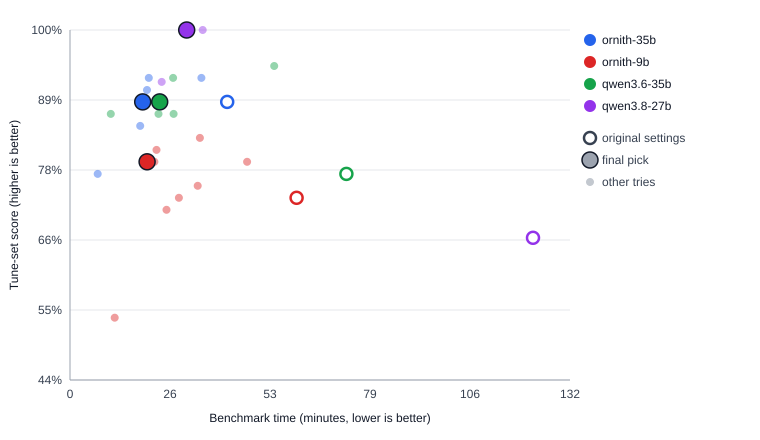

# Iterated Testing

Benchmark local [llama.cpp](https://github.com/ggml-org/llama.cpp) models on coding-agent work, then
tune their launch settings one change at a time until each model is as fast as it can be without
getting less accurate.

Built for a gaming laptop (RTX 3070 Ti 8 GB, 32 GB RAM) running four Qwen3.5-family models for
[OpenCode](https://opencode.ai), but nothing in it is specific to that machine: point
`config/local.toml` at your own `llama-server` and model files.

## Results

All four models converged after 10 of the 20 allowed tuning iterations. The final test then ran each
model's original launcher settings and its tuned settings on 30 held-out tasks that tuning never saw:

| Model | Original settings | Tuned settings | Speed-up |
|---|---|---|---|
| ornith-35b (MoE, 35B total / 3B active) | 65.6% in 31.9 min | 68.8% in 13.3 min | 2.4x |
| ornith-9b (dense 9B, fully on the GPU) | 71.9% in 35.1 min | 75.0% in 14.7 min | 2.4x |
| qwen3.6-35b (MoE, 35B total / 3B active) | 62.5% in 51.9 min | 81.2% in 14.9 min | 3.5x |
| qwen3.8-27b (dense 27B, half on the CPU) | 75.0% in 75.2 min | 100% in 21.5 min | 3.5x |

The 27B ran an 8-task subset (it writes about 3 tokens per second), so its scores are a rough check.
The ornith gains (3.1 points each) are within noise: their tuned settings are as accurate and more
than twice as fast.

What made the difference:

* **A thinking budget.** With unlimited thinking, the original settings often used up a task's output
  cap before writing any code (2 to 9 cut-off answers per held-out run, none after tuning). A budget
  of 1024 thinking tokens (2048 for the 9B) cut run times by 44 to 63% and kept or raised accuracy.
  Turning thinking off cost the three faster models 8 to 25 points; the 27B, at about 3 tokens per
  second, scored higher with thinking off than with unlimited thinking.
* **Speed settings** cut another 12 to 15% per run, and 32% for the 9B, which fits entirely on the GPU
  only with a 512 MiB VRAM margin for `--fit` (llama.cpp's default is 1024 MiB): its writing speed went
  from 39 to 62 tokens per second. For the others: no memory-mapping (`--load-mode none`), bigger
  batches, more CPU threads and a smaller VRAM margin.
* **What did not help:** the vendor's recommended sampling preset (presence penalty 1.5, temperature
  1.0) never helped. A 4-bit KV cache saved only 1 to 4% on the three faster models (these hybrid
  models keep a KV cache in only a quarter of their layers) and lost tasks on two of them; the 9B's pick
  uses it, but its last four candidates are tied within noise. On the 27B it was 21% faster but lost
  one of its 12 tasks, a difference the small subset cannot tell from noise. MTP speculative decoding
  was slower for prose on this laptop.
* **One held-out task has a defective check** (`fbf04` rejects the textbook fix). Counted fairly, the
  9B's held-out gain becomes a tie, and the other gaps do not change.



Every iteration, probe and decision is in [results/REPORT.md](results/REPORT.md); the design, the
noise, the held-out task review and every judgment call made during the run are in
[docs/METHOD.md](docs/METHOD.md).

## What it does

1. **Benchmarks** a model with 49 original tasks (7 to 73 minutes per run here, depending on how long
   the model thinks): tool calls, function writing, bug fixes, long-context code tracing (8K-24K
   tokens), and multi-turn agent repairs of small repos. Everything is graded automatically: hidden
   unit tests, exact answers computed by running code, or argument checks. No model ever grades
   another model.
2. **Iterates**: each iteration benchmarks one change per model (thinking settings first: a
   4096-token thinking budget as a reference, then thinking off and smaller budgets; then speed
   calibration, sampling preset, KV-cache precision) and keeps it only if accuracy holds (within a
   4-point tie band of the best run) and it is faster. It stops when every model has converged, or
   after 20 iterations.
3. **Calibrates speed** with short probes for settings that cannot change answers (CPU threads, load
   mode, micro-batch size, VRAM margin), instead of spending full benchmarks on them.
4. **Final test** on 30 held-out tasks never used during tuning: original settings vs tuned settings.
5. **Reports** a Markdown report, a CSV of every run, a score-vs-time chart, and ready-to-use
   `.bat` launchers with the tuned flags.

See [docs/METHOD.md](docs/METHOD.md) for the details and the reasoning behind the design.

## Quick start

Python 3.11+ and nothing else (standard library only). An NVIDIA GPU is optional (used for telemetry).

```bash
cp config/local.example.toml config/local.toml      # then edit the two paths
python -m iterbench doctor                           # checks paths, GPU, sandbox
python -m iterbench validate                         # checks every task's reference solution
python -m iterbench bench --model ornith-9b --limit 5   # quick smoke test
python -m iterbench tune                             # the full loop (hours); resumable
python -m iterbench final                            # held-out test
python -m iterbench report && python -m iterbench launchers
```

Other commands: `status` (tuning progress), `probe` (one speed probe), `bench --set reasoning=off`
(try any flag by hand). Models, baseline flags and the search space live in
[config/models.toml](config/models.toml).

Close any other `llama-server` first: the harness refuses to start if the GPU is busy, because a
shared GPU would make every speed number wrong.

## With OpenCode

The tuned launchers work with OpenCode as they are. The benchmark sends no sampling settings, so
the server's launch flags decide them, and OpenCode 1.19.5 does the same for models defined in
`opencode.json`: it sends `temperature` only for a model marked `"temperature": true`, and no
`top_p`, penalties or thinking settings. Its title requests add `reasoning_effort: "low"`, which
changes nothing here: three of the four chat templates never read it, and the 27B's reads it only
with thinking on. OpenCode's output limit (`limit.output`, 16K-32K tokens in this setup) is higher
than the benchmark's caps, so answers are rarely cut off there; the thinking budget is what keeps
turns short. Checked by pointing OpenCode at a stub server that records each request
([scripts/record_requests.py](scripts/record_requests.py)), reading the chat templates
([scripts/gguf_info.py](scripts/gguf_info.py)), and comparing seeded output with and without the field
([scripts/check_reasoning_effort.py](scripts/check_reasoning_effort.py)).

## Layout

```
config/          models.toml (models, baseline flags, search space), local.toml (your paths)
iterbench/       the harness: server control, client, graders, tuner, report
tasks/tune/      tasks used while tuning
tasks/final/     held-out tasks for the final test
tests/           unit tests for the harness (python -m unittest discover -s tests)
docs/            METHOD.md: design, noise, held-out review, judgment calls made during the run
scripts/         checks behind the findings, run by hand (not part of the benchmark):
                   task_matrix.py           per-task pass/fail across runs (noise, held-out review)
                   smoke_budget.py          does --reasoning-budget stop thinking and still answer?
                   smoke_spec.py            does MTP speculative decoding help?
                   gguf_info.py             model architecture and what its chat template reads
                   record_requests.py       what does a client such as OpenCode send?
                   check_reasoning_effort.py  does OpenCode's reasoning_effort field change anything?
results/         the report, per-run CSV, chart, best configs (committed)
runs/            raw outputs, server logs, tuner state (gitignored)
launchers/       generated .bat files with tuned flags (gitignored, contain local paths)
```

## Caveats

* About 50 tasks is enough to catch real regressions (a broken setting, a thinking budget that is
  too small) but not 1-2 point differences. Two runs that differ only in speed settings (which cannot
  change accuracy) differed on 7 or 8 of 49 tasks, so one run's score has a standard deviation of
  about 4 points. The report shows 95% intervals, and ties are broken by speed: a pick is the fastest
  setting within the noise, not a proven best.
* Every request has an output cap (4096 to 8192 tokens, thinking included), and a cut-off answer
  fails. That is what makes unlimited thinking expensive here. Without a cap, the original settings
  would solve some of those tasks, at several minutes each.
* The tuned VRAM margins are tight. `--fit-target 256` leaves 256 MiB of VRAM free, measured with
  nothing else on the GPU; it buys only 2 to 4% over the default (9% for the 27B), and qwen3.6-35b with
  a full-precision KV cache did not fit with it. If the server runs out of memory, or another program
  needs the GPU, raise it: each launcher lists what a bigger margin cost in the probes. The 9B's
  512 MiB margin is the exception that matters: at the default, part of the model leaves the GPU and
  agent turns take 47% longer.
* Running model-written code is guarded (no processes, no network, no writes outside a scratch
  folder, 1 GB memory cap, timeouts), but it is not a security sandbox.
* Laptop GPUs throttle. Every run logs GPU temperature, clocks and throttle reasons so a slow run can
  be told apart from a slow setting.
