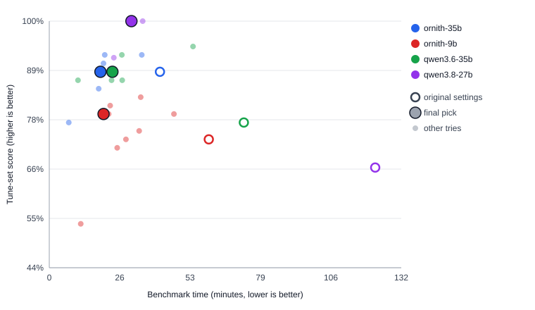

# Results

Machine: 12th Gen Intel(R) Core(TM) i7-12700H, NVIDIA GeForce RTX 3070 Ti Laptop GPU, 8192 MiB, 32 GB RAM. llama.cpp 1.0.0-dev (build 12386, commit c6c0ec6d5). Python 3.12.10.

Tuning iterations completed: 10 (cap 20). Tie tolerance: 4 points; a tie only replaces the current pick if it is at least 5% faster.

Scores are the weighted share of benchmark tasks passed (agent tasks count double). "Time" is the wall-clock time for the whole task set, excluding model loading. Write and read speeds are tokens per second, averaged over every request in the run.

## Summary

| Model | Original: score / time | Tuned: score / time | Speed-up | Held-out original | Held-out tuned | Held-out speed-up | Status |
|---|---|---|---|---|---|---|---|
| ornith-35b | 88.5% / 41m 33s | 88.5% / 19m 13s | 2.16x | 65.6% / 31m 53s | 68.8% / 13m 17s | 2.40x | converged (8 runs) |
| ornith-9b | 73.1% / 59m 53s | 78.8% / 20m 22s | 2.94x | 71.9% / 35m 05s | 75.0% / 14m 42s | 2.39x | converged (10 runs) |
| qwen3.6-35b | 76.9% / 1h 13m | 88.5% (90.4% averaged) / 23m 41s | 3.08x | 62.5% / 51m 55s | 81.2% / 14m 54s | 3.48x | converged (8 runs) |
| qwen3.8-27b | 66.7% / 2h 02m | 100.0% / 30m 51s | 3.97x | 75.0% / 1h 15m | 100.0% / 21m 31s | 3.49x | converged (4 runs) |

## ornith-35b

Daily driver. qwen35moe, 35B total / 3B active, APEX I-Compact 17.3 GB.

| It | Change tried | Score (95% CI) | Time | Write tok/s | Read tok/s | Thinking tokens | Cut off | Decision |
|---|---|---|---|---|---|---|---|---|
| 1 | original launcher settings | 88.5% (77-95) | 41m 33s | 48.1 | 610 | 97,399 | 4 | baseline |
| 2 | reasoning-budget=4096 | 92.3% (82-97) | 34m 44s | 49.0 | 627 | 76,365 | 0 | accepted |
| 3 | reasoning=off, -reasoning-budget | 76.9% (64-86) | 7m 18s | 49.9 | 615 | 0 | 0 | rejected: accuracy 76.9% is more than 4 points below the best (92.3%) |
| 4 | reasoning-budget=1024 | 88.5% (77-95) | 22m 34s | 49.2 | 624 | 35,385 | 0 | accepted |
| 5 | fit-target=256, load-mode=none | 88.5% (77-95) **(pick)** | 19m 13s | 50.8 | 748 | 34,319 | 0 | accepted |
| 6 | presence-penalty=1.5, temp=1 | 90.4% (79-96) | 20m 20s | 48.0 | 753 | 34,534 | 0 | rejected: not faster than the current pick |
| 7 | cache-type-k=q4_0, cache-type-v=q4_0 | 84.6% (72-92) | 18m 32s | 51.9 | 774 | 34,846 | 0 | rejected: accuracy 84.6% is more than 4 points below the best (92.3%) |
| 8 | cache-type-k=f16, cache-type-v=f16 | 92.3% (82-97) | 20m 49s | 49.2 | 717 | 35,129 | 0 | rejected: not faster than the current pick |

Per category for the pick: toolcall 12/12, codegen 14/20, bugfix 8/8, longctx 6/6, agent 3/3

Speed calibration probes (16K-token prompt; s/turn = 3000/read + 500/write@16K):

| Setting | Read tok/s | Write@16K tok/s | Write@0 tok/s | s/turn |
|---|---|---|---|---|
| current settings | 1036 | 48.0 | 52.6 | 13.30 |
| 6 threads (P-cores) | 1045 | 45.1 | 45.5 | 13.96 |
| 8 threads | 1070 | 46.2 | 47.5 | 13.63 |
| 10 threads | 1074 | 45.8 | 47.8 | 13.72 |
| 12 threads | 1063 | 46.7 | 49.8 | 13.52 |
| 20 threads | 1059 | 45.5 | 50.0 | 13.82 |
| load-mode none (no mmap) | 1280 | 48.5 | 51.2 | 12.66 |
| ubatch 512 | 507 | 49.0 | 52.4 | 16.13 |
| ubatch 1024 | 861 | 48.7 | 51.9 | 13.76 |
| ubatch 4096 | 1709 | 45.6 | 45.1 | 12.72 |
| fit margin 512 MiB | 1323 | 48.9 | 52.3 | 12.49 |
| fit margin 256 MiB | 1341 | 49.3 | 50.2 | 12.38 |

Pick vs original launcher: `fit-target=256, load-mode=none, reasoning-budget=1024`

Full flags: `--ctx-size 131072 --flash-attn on --cache-type-k q8_0 --cache-type-v q8_0 --ubatch-size 2048 --parallel 1 --cache-ram 4096 --checkpoint-min-step 2048 --temp 0.6 --top-p 0.95 --top-k 20 --min-p 0 --reasoning-budget 1024 --load-mode none --fit-target 256`

Held-out (final) test:

| Settings | Score (95% CI) | Time | Write tok/s | Cut off | Solved/hour |
|---|---|---|---|---|---|
| baseline | 65.6% (48-80) | 31m 53s | 47.7 | 5 | 39.5 |
| tuned | 68.8% (51-82) | 13m 17s | 50.3 | 0 | 99.3 |

## ornith-9b

qwen35 dense 9B, Q4_K_M 5.6 GB, fits on the GPU.

| It | Change tried | Score (95% CI) | Time | Write tok/s | Read tok/s | Thinking tokens | Cut off | Decision |
|---|---|---|---|---|---|---|---|---|
| 1 | original launcher settings | 73.1% (60-83) | 59m 53s | 39.1 | 1425 | 124,216 | 7 | baseline |
| 2 | reasoning-budget=4096 | 78.8% (66-88) | 46m 47s | 39.2 | 1430 | 84,974 | 1 | accepted |
| 3 | reasoning=off, -reasoning-budget | 53.9% (40-67) | 11m 49s | 39.6 | 1409 | 0 | 1 | rejected: accuracy 53.9% is more than 4 points below the best (78.8%) |
| 4 | reasoning-budget=1024 | 73.1% (60-83) | 28m 46s | 39.4 | 1448 | 34,491 | 2 | rejected: accuracy 73.1% is more than 4 points below the best (78.8%) |
| 5 | reasoning-budget=2048 | 75.0% (62-85) | 33m 45s | 39.2 | 1444 | 54,794 | 0 | accepted |
| 6 | fit-target=512 | 80.8% (68-89) | 22m 52s | 60.9 | 1915 | 51,025 | 2 | accepted (accuracy counted as 77.9%, the average with the run it was built from) |
| 7 | presence-penalty=1.5, temp=1 | 71.2% (58-82) | 25m 30s | 60.9 | 1942 | 54,260 | 2 | rejected: accuracy 71.2% is more than 4 points below the best (78.8%) |
| 8 | cache-type-k=q4_0, cache-type-v=q4_0 | 78.8% (66-88) | 22m 18s | 60.9 | 1938 | 53,753 | 1 | rejected: not faster than the current pick |
| 9 | cache-type-k=f16, cache-type-v=f16 | 82.7% (70-91) | 34m 19s | 35.1 | 1359 | 52,127 | 0 | rejected: not faster than the current pick; its score raised the best to 82.7%, so the old pick (iteration 6, 77.9%) fell out of the band and the pick moved to iteration 8 (KV q4_0) |
| 10 | repeat-penalty=1 | 78.8% (66-88) **(pick)** | 20m 22s | 62.5 | 1940 | 55,438 | 0 | accepted |

Per category for the pick: toolcall 11/12, codegen 10/20, bugfix 8/8, longctx 6/6, agent 3/3

Speed calibration probes (16K-token prompt; s/turn = 3000/read + 500/write@16K):

| Setting | Read tok/s | Write@16K tok/s | Write@0 tok/s | s/turn |
|---|---|---|---|---|
| current settings | 1868 | 39.0 | 41.0 | 14.42 |
| 6 threads (P-cores) | 1874 | 38.7 | 40.8 | 14.52 |
| 8 threads | 1875 | 39.3 | 41.2 | 14.33 |
| 10 threads | 1870 | 39.1 | 41.0 | 14.39 |
| 12 threads | 1856 | 39.3 | 41.0 | 14.33 |
| 20 threads | 1836 | 36.2 | 39.9 | 15.44 |
| load-mode none (no mmap) | 1884 | 38.9 | 40.8 | 14.45 |
| ubatch 512 | 1843 | 39.0 | 40.7 | 14.46 |
| ubatch 1024 | 2009 | 32.3 | 37.5 | 16.96 |
| ubatch 2048 | 2064 | 29.8 | 33.8 | 18.22 |
| ubatch 4096 | 1973 | 21.8 | 22.8 | 24.51 |
| fit margin 512 MiB | 2318 | 58.7 | 63.1 | 9.81 |
| fit margin 256 MiB | 2324 | 58.4 | 63.1 | 9.86 |

Pick vs original launcher: `cache-type-k=q4_0, cache-type-v=q4_0, fit-target=512, reasoning-budget=2048, repeat-penalty=1`

Full flags: `--ctx-size 65536 --flash-attn on --cache-type-k q4_0 --cache-type-v q4_0 --parallel 1 --cache-ram 4096 --checkpoint-min-step 2048 --temp 0.6 --top-p 0.95 --top-k 20 --min-p 0 --repeat-penalty 1 --reasoning-budget 2048 --fit-target 512`

Held-out (final) test:

| Settings | Score (95% CI) | Time | Write tok/s | Cut off | Solved/hour |
|---|---|---|---|---|---|
| baseline | 71.9% (55-84) | 35m 05s | 38.8 | 3 | 39.3 |
| tuned | 75.0% (58-87) | 14m 42s | 62.5 | 0 | 97.9 |

## qwen3.6-35b

qwen35moe, Q4_K_M 21.8 GB; tight on 32 GB RAM.

| It | Change tried | Score (95% CI) | Time | Write tok/s | Read tok/s | Thinking tokens | Cut off | Decision |
|---|---|---|---|---|---|---|---|---|
| 1 | original launcher settings | 76.9% (64-86) | 1h 13m | 44.5 | 483 | 179,000 | 10 | baseline |
| 2 | reasoning-budget=4096 | 94.2% (84-98) | 53m 57s | 44.8 | 487 | 122,931 | 0 | accepted |
| 3 | reasoning=off, -reasoning-budget | 86.5% (75-93) | 10m 47s | 45.0 | 488 | 0 | 0 | rejected: accuracy 86.5% is more than 4 points below the best (94.2%) |
| 4 | reasoning-budget=1024 | 92.3% (82-97) | 27m 14s | 44.6 | 487 | 37,174 | 1 | accepted |
| 5 | batch-size=4096, fit-target=256, load-mode=none, threads=12, ubatch-size=4096 | 88.5% (77-95) **(pick)** | 23m 41s | 45.4 | 652 | 38,250 | 0 | accepted (accuracy counted as 90.4%, the average with the run it was built from); re-evaluated after a rule change, see docs/METHOD.md |
| 6 | presence-penalty=1.5, temp=1 | 86.5% (75-93) | 27m 23s | 42.7 | 678 | 38,822 | 0 | rejected: accuracy 86.5% is more than 4 points below the best (94.2%) |
| 7 | cache-type-k=q4_0, cache-type-v=q4_0 | 86.5% (75-93) | 23m 24s | 46.5 | 710 | 38,532 | 1 | rejected: accuracy 86.5% is more than 4 points below the best (94.2%) |
| 8 | cache-type-k=f16, cache-type-v=f16 | -% | - | - | - | - | - | failed: server failed to start: llama-server exited with code 3221226505 while loading (CUDA error: out of memory) |

Per category for the pick: toolcall 11/12, codegen 16/20, bugfix 8/8, longctx 5/6, agent 3/3

Speed calibration probes (16K-token prompt; s/turn = 3000/read + 500/write@16K):

| Setting | Read tok/s | Write@16K tok/s | Write@0 tok/s | s/turn |
|---|---|---|---|---|
| current settings | 658 | 40.8 | 42.0 | 16.83 |
| 6 threads (P-cores) | 844 | 41.6 | 42.7 | 15.57 |
| 8 threads | 842 | 43.3 | 45.0 | 15.10 |
| 10 threads | 849 | 44.1 | 45.9 | 14.87 |
| 12 threads | 858 | 44.5 | 46.9 | 14.73 |
| 20 threads | 845 | 41.1 | 42.5 | 15.72 |
| load-mode none (no mmap) | 1024 | 45.0 | 46.9 | 14.05 |
| ubatch 512 | 375 | 46.0 | 48.7 | 18.87 |
| ubatch 1024 | 649 | 45.2 | 47.3 | 15.68 |
| ubatch 4096 | 1419 | 43.3 | 44.3 | 13.67 |
| fit margin 512 MiB | 1457 | 44.1 | 45.8 | 13.40 |
| fit margin 256 MiB | 1474 | 45.0 | 47.0 | 13.14 |

Pick vs original launcher: `batch-size=4096, fit-target=256, load-mode=none, reasoning-budget=1024, threads=12, ubatch-size=4096`

Full flags: `--ctx-size 131072 --flash-attn on --cache-type-k q8_0 --cache-type-v q8_0 --ubatch-size 4096 --parallel 1 --cache-ram 4096 --checkpoint-min-step 2048 --temp 0.6 --top-p 0.95 --top-k 20 --min-p 0 --reasoning-budget 1024 --threads 12 --load-mode none --batch-size 4096 --fit-target 256`

Held-out (final) test:

| Settings | Score (95% CI) | Time | Write tok/s | Cut off | Solved/hour |
|---|---|---|---|---|---|
| baseline | 62.5% (45-77) | 51m 55s | 44.2 | 9 | 23.1 |
| tuned | 81.2% (65-91) | 14m 54s | 45.1 | 0 | 104.7 |

## qwen3.8-27b

qwen35 dense 27B, IQ3_S 12.3 GB, about half on the CPU.

| It | Change tried | Score (95% CI) | Time | Write tok/s | Read tok/s | Thinking tokens | Cut off | Decision |
|---|---|---|---|---|---|---|---|---|
| 1 | original launcher settings | 66.7% (39-86) | 2h 02m | 3.1 | 249 | 21,215 | 4 | baseline |
| 2 | reasoning=off | 100.0% (76-100) | 35m 04s | 3.1 | 246 | 0 | 0 | accepted |
| 3 | fit-target=256, threads=20 | 100.0% (76-100) **(pick)** | 30m 51s | 3.5 | 265 | 0 | 0 | accepted |
| 4 | cache-type-k=q4_0, cache-type-v=q4_0 | 91.7% (65-98) | 24m 14s | 3.8 | 264 | 0 | 0 | rejected: accuracy 91.7% is more than 4 points below the best (100.0%) |

Per category for the pick: toolcall 3/3, codegen 5/5, bugfix 2/2, longctx 2/2

Speed calibration probes (16K-token prompt; s/turn = 3000/read + 500/write@16K):

| Setting | Read tok/s | Write@16K tok/s | Write@0 tok/s | s/turn |
|---|---|---|---|---|
| current settings | 451 | 2.7 | 3.1 | 191.00 |
| 6 threads (P-cores) | 469 | 2.3 | 2.5 | 222.66 |
| 8 threads | 469 | 2.4 | 2.7 | 214.48 |
| 10 threads | 471 | 2.6 | 2.9 | 201.87 |
| 12 threads | 468 | 2.6 | 3.0 | 195.68 |
| 20 threads | 443 | 3.0 | 3.4 | 171.20 |
| load-mode none (no mmap) | 478 | 3.0 | 3.3 | 171.40 |
| ubatch 512 | 333 | 3.1 | 3.4 | 170.30 |
| ubatch 2048 | 509 | 3.0 | 3.0 | 171.92 |
| ubatch 4096 | 531 | 2.8 | 3.0 | 184.26 |
| fit margin 512 MiB | 463 | 3.2 | 3.6 | 161.01 |
| fit margin 256 MiB | 469 | 3.3 | 3.7 | 156.41 |

Pick vs original launcher: `fit-target=256, reasoning=off, threads=20`

Full flags: `--ctx-size 32768 --flash-attn on --cache-type-k q8_0 --cache-type-v q8_0 --ubatch-size 1024 --parallel 1 --cache-ram 4096 --checkpoint-min-step 2048 --temp 1 --top-p 0.95 --top-k 20 --min-p 0 --reasoning off --threads 20 --fit-target 256`

Held-out (final) test:

| Settings | Score (95% CI) | Time | Write tok/s | Cut off | Solved/hour |
|---|---|---|---|---|---|
| baseline | 75.0% (41-93) | 1h 15m | 3.1 | 2 | 4.8 |
| tuned | 100.0% (68-100) | 21m 31s | 3.5 | 0 | 22.3 |

## How to read this

* With about 50 tasks, one task is about 2 points, so differences of a few points are within noise (see the 95% intervals). The tuner treats anything within the tie tolerance as equal and then prefers the faster setting.
* The held-out set was never used while tuning, so it is the fairest comparison of original vs tuned. Its tasks are different, so compare original and tuned within one set, not scores across the two sets.
* Speed settings (threads, batch size, load mode, VRAM margin) cannot make a model more or less accurate; they were chosen with short speed probes rather than full benchmarks. They do change the exact arithmetic, so the sampled answers differ from run to run: the speed-calibrated run counts as the average of itself and the run it was built from.
* "Cut off" counts requests that reached the output cap before the model finished; that answer counts as a failure (see docs/METHOD.md, "Output caps").
* qwen3.8-27b ran the `lite` subset (12 tuning tasks, 8 held-out) because it writes only a few tokens per second. There, one task is 8 to 12.5 points, so any lost task puts a change outside the tie band, and its held-out comparison is only a rough check.
* No held-out run passed `final/fbf04` (bugfix, 6 runs). A task that every setting fails cannot tell settings apart, and it may be broken rather than hard; see docs/METHOD.md, "Held-out test".
